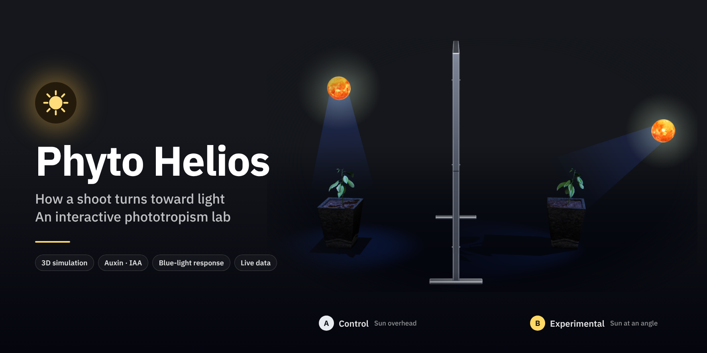
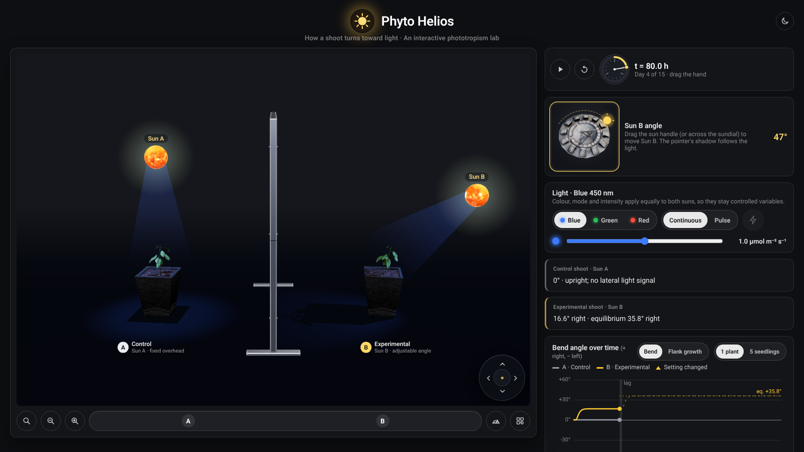
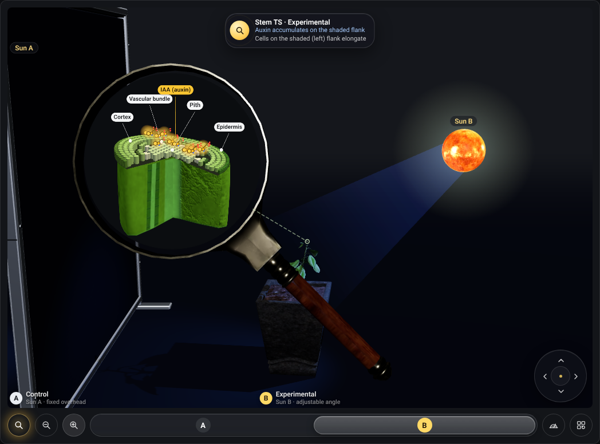
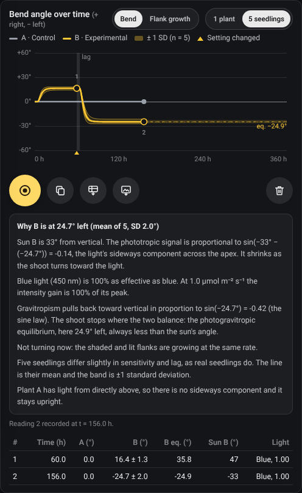
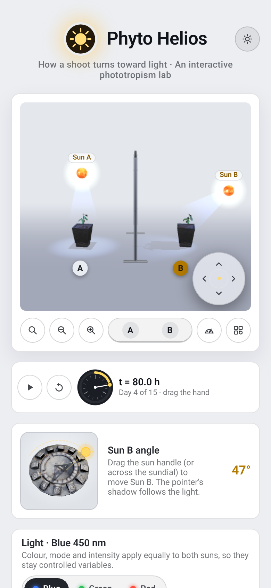

  

<h1 align="center">Phyto Helios</h1>

<i>How a shoot turns toward light · An interactive phototropism lab</i>

<b><a href="https://dray-ashcroft.github.io/Phyto-Helios/">Launch Phyto Helios</a></b>

  <a href="#about">About</a> ·
  <a href="#screenshots">Screenshots</a> ·
  <a href="#features">Features</a> ·
  <a href="#controls">Controls</a> ·
  <a href="#science">Science</a> ·
  <a href="#technology">Technology</a> ·
  <a href="#credits">Credits</a> ·
  <a href="#releases">Releases</a> ·
  <a href="#license">License</a>

---

## About

Phyto Helios is a 3D phototropism lab for the classroom. Two seedlings grow on either side of a light-tight partition: plant A under a sun fixed overhead (the control), and plant B under a sun whose angle the learner sets on a sundial (the experimental plant). Over a simulated 15 days, plant B turns toward its light while plant A grows straight up.

The bend is calculated, not animated. The model links the light's sideways component, auxin redistribution, differential flank growth and gravitropic straightening, and settles at the photogravitropic equilibrium. A magnifier shows the transverse section of the stem, with IAA moving to the shaded flank and cells there elongating. A live chart, readings table and CSV export turn each run into data that students can analyse.

## Screenshots

<table>
  <tr>
    <td width="50%"> <b>1 · Split-screen lab</b></td>
    <td width="50%"> <b>2 · Stem TS under the magnifier</b></td>
  </tr>
  <tr>
    <td width="50%"> <b>3 · Data, readings and reasoning</b></td>
    <td width="50%"> <b>4 · Mobile, light theme</b></td>
  </tr>
</table>

## Features

| Feature | What You See | Tap to Explore |
|---|---|---|
| Two rooms | Control (A) and experimental (B) seedlings behind a blackout partition | A / B switch flies the camera to each room |
| Sundial | Sun B moves along its arc; the gnomon shadow follows | Drag the sun handle or the dial |
| Light | Blue, green or red light; continuous or 1 h pulses; 0.01 to 100 µmol m⁻² s⁻¹ | Colour and mode chips, pulse button, intensity slider |
| Magnifier | Labelled stem TS: epidermis, cortex, vascular bundles, pith; IAA molecules gather on the shaded flank | Magnifier button, drag the lens over a shoot apex |
| Measurement | Protractor over the shoot; live bend angle | Protractor button |
| Data | Bend over time or flank growth; 1 plant or 5 seedlings with ±1 SD | Record, copy CSV, save CSV or chart PNG |
| Reasoning | A live explanation of why plant B sits at its current angle | Read under the chart |

**Concepts:** Positive phototropism · Cholodny–Went hypothesis · Auxin (IAA) redistribution · Phototropins and the blue-light action spectrum · Lag phase · Differential flank growth · Gravitropic sine law · Photogravitropic equilibrium · First-positive (pulse) curvature · Controlled variables · Replicates and standard deviation

## Controls

| Control | Function |
|---|---|
| Play / Pause, clock | Run 360 h in 90 s, or drag the clock hand to any hour |
| Sundial | Set Sun B from −55° to +55° (arrow keys: 1°, Shift: 5°) |
| A / B switch | Focus the camera on room A or room B |
| Navigation pad, arrow keys | Orbit the camera; drag or pinch the scene to rotate and zoom |
| Reset layout | Return the camera and magnifier to the starting view |
| Reset | Restart the simulation at 0 h with Sun B overhead |
| Theme | Switch between the dark and light themes |

## Science

<b>Model and sources</b>

| Part | How it is modelled | Source |
|---|---|---|
| Lag | Curvature starts about 4.5 h after continuous unilateral blue light | Cucumber hypocotyl kinetics, Photochemistry and Photobiology |
| Intensity | Response peaks near 1 µmol m⁻² s⁻¹; above it the lag lengthens and curvature is reduced | Whippo & Hangarter, Plant Physiology 2003 |
| Colour | Blue is fully effective, green weakly (illustrative), red not at all | Phototropism action spectrum (phototropins) |
| Bend | dθ/dt = Kp·s − Kg·sin θ, with auxin signal s built from W(λ)·g(I)·sin(φ − θ) | Bastien, Douady & Moulia 2015; Galland et al., Planta 2002 |
| Growth | Shaded flank elongates faster, lit flank slower | Cholodny–Went; Plant Physiology growth-distribution studies |

The 360 h timeline compresses seedling growth for display. The Kp : Kg ratio, pulse strength, green-light weight and seedling variation are illustrative.

## Technology

HTML · CSS · JavaScript (ES modules) · three.js r160 · WebGL · glTF · Canvas 2D · IBM Plex Sans · Roboto

<b>Project files</b>

| File | Contents |
|---|---|
| `index.html` | Page structure, import map for three.js |
| `css/style.css` | Layout (split screen at 900 px and wider), dark and light themes, components |
| `js/app.js` | 3D scene, photogravitropic model, magnifier, sundial, chart, readings, export |
| `assets/models/` | Optimised glTF models: plant, sun, magnifier, stem section, sundial |
| `assets/screenshots/` | README screenshots |

Serve the folder over HTTP (for example GitHub Pages or `python -m http.server`). Opening `index.html` directly from disk blocks the module scripts and models.

## Credits

| Contributor | Role |
|---|---|
| Sai Prasad, M.Sc. Agri. Entomology, ASRB NET | Project Designer |
| Anthropic: Claude Opus 5.5 | Code Architecture |
| OpenAI: GPT Astra 6 | Debugging, Scientific Reasoning |
| DeepSeek AI: R1 | Debugging |

<b>3D models</b>

| Asset | Model | Creator | Licence |
|---|---|---|---|
| Plant | [Avocady](https://skfb.ly/oY7EL) | Wenschel | CC BY 4.0 |
| Suns | [Sun](https://skfb.ly/6U8EY) | PatelDev | CC BY 4.0 |
| Magnifier | [Styled Magnifying Glass](https://skfb.ly/oyYpS) | Incg5764 | CC BY 4.0 |
| Stem section | Root Structure | arloopa | CC BY 4.0 |
| Sundial | [Sundial "Zodiac" in the Square them. Anna Herman](https://skfb.ly/69ZRU) | johankarpov | CC BY-NC-SA 4.0 |

All models were optimised for the web (geometry simplified, textures resized). The plant shoot is scaled and bent at runtime. The root model was turned apex-up, recoloured, stripped of labels and root hairs, cut transversely and given a cellular stem section. The sundial was re-oriented. Licences: [CC BY 4.0](http://creativecommons.org/licenses/by/4.0/), [CC BY-NC-SA 4.0](http://creativecommons.org/licenses/by-nc-sa/4.0/) (sundial: non-commercial use; adaptations share alike).

<b>Libraries and fonts</b>

| Component | Licence |
|---|---|
| three.js r160 (GLTFLoader, OrbitControls, RoundedBoxGeometry, RoomEnvironment) | MIT |
| IBM Plex Sans | SIL Open Font License 1.1 |
| Roboto | SIL Open Font License 1.1 |

## Releases

| Release | Title | Date |
|---|---|---|
| RC I | Phyto Helios | 24 Nov 2026 |

## License

Source code is released under the [GNU General Public License v3.0](LICENSE). 3D models remain under their creators' licences listed above.

<a href="https://github.com/Dray-Ashcroft/Phyto-Helios">GitHub</a>

